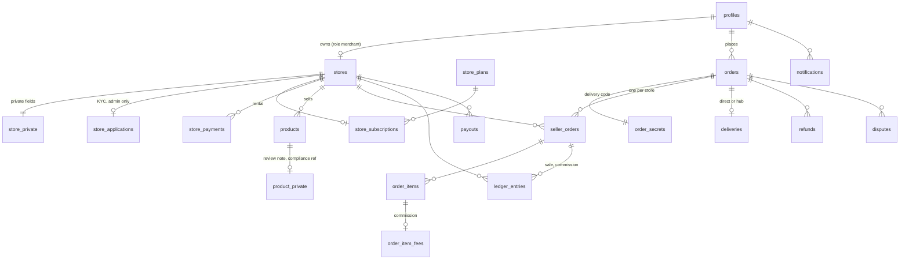

# Everneed01 data model (Phase 2)

Migrations `000` to `008` in `supabase/migrations/`. Text ids (uuid strings) everywhere, matching the original tables.
Money: `ledger_entries`, `seller_orders`, `order_item_fees` are in NGN. `orders.total` and `order_items.unit_price/line_total` are in the order currency.
Discounts are funded by EverNeed: sellers earn on the full base price.

## Where private data lives
| Public table | Private side table | What is kept private |
|---|---|---|
| `stores` | `store_private` | pickup address, phone, status note, delivery zones, commission override, trusted flag |
| `stores` | `store_applications` | business name, ID reference, bank details (owner and admin only) |
| `products` | `product_private` | review note, reviewer, compliance reference |
| `orders` | `order_secrets` | delivery code (customer and admin only) |
| `order_items` | `order_item_fees` | commission rate and amount (merchant and admin only) |

Decision: the spec lists some of these fields on the public tables. They are split out so a base table can be granted to anonymous visitors without column tricks.

## State machines (enforced by triggers, for everyone)
- Parent order: pre-payment labels (`awaiting_payment`, `awaiting_transfer`, `payment_reported`, `awaiting_delivery`, `sent`) then `paid > confirmed > preparing > ready_for_delivery > out_for_delivery > delivered`, plus `cancelled` and `disputed`. `paid` can only be set by `confirm_payment()`. Legacy `shipped` stays as an alias of `out_for_delivery` and is retired in Phase 3.
- Seller order: `pending > accepted | rejected | cancelled`, `accepted > preparing > ready`, then direct: `ready > out_for_delivery > delivered`; hub: `ready > handover_pending > at_hub > consolidated > out_for_delivery > delivered`. Any active step can go to `issue` (admin).
- The parent order follows its seller orders through `private.sync_order()`.

## Server functions
Client-callable (each checks who is calling, rate limited): `report_payment`, `cancel_order`, `confirm_received`, `order_tracking`, `mark_delivered`, `submit_store`, `seller_transition`, `my_seller_orders`, `store_balance`; admin only: `approve_store`, `reject_store`, `suspend_store`, `review_product`, `set_store_terms`, `hub_receive`, `hub_consolidate`, `dispatch`, `refund`, `admin_confirm_payment`, `apply_rental_payment`, `record_payout`.
Service role only (Edge Function and schedulers): `create_order`, `confirm_payment`, `cancel_order_for`, `confirm_received_for`, `apply_rental_payment_for`, `release_earnings`, `expire_rentals`, `run_scheduled_jobs`.
`run_scheduled_jobs()` needs a schedule (Supabase scheduled function or pg_cron, hourly): it releases earnings after the holding period, expires rentals, cancels and refunds orders a seller did not accept in time, and auto-confirms deliveries.

## Policy knobs
`settings` row `policy` (admin only): `commission_pct`, `category_commission`, `payout_hold_days`, `auto_confirm_days`, `accept_hours`, `trial_days`, `grace_days`, `direct_enabled`, `auto_approve_trusted`. Row `hub`: handover address and instructions (merchants can read it).
`hub_fee` and `direct_fee` exist in the policy row but are not applied yet; delivery fees still come from each country's settings row.

## Known gaps
- Refunds are recorded and approved here; the money itself is returned through Paystack or bank by an admin (Phase 4 adds the Paystack refund call).
- `deliveries` for legacy official-store orders are not backfilled; their admin flow is unchanged.
- Legacy official-store orders have no ledger history; only orders confirmed after migration 007 post ledger entries.
